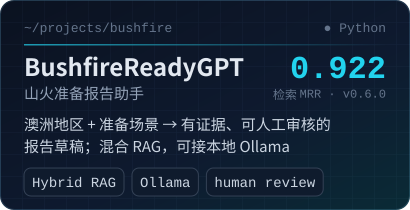
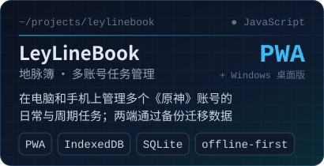
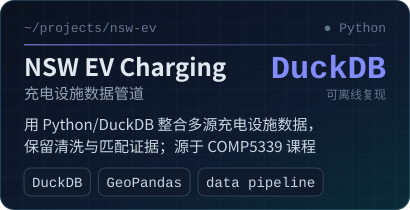
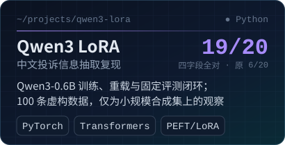

**AI Agent / LLM 应用开发 · AgentScope 与 oxc 开源贡献者**

我做可验证的 AI Agent 与 RAG 应用：先固定证据再让模型推理，实验先写方案再运行，结果和不足一起公开。  
I build verifiable AI agents and RAG apps: evidence first, pre-registered evaluation, results published with their limits.

悉尼大学计算机硕士 · Master of Computer Science @ The University of Sydney · **2027 届**

邮箱：`shuxiachai@163.com` / `jingbochai2002@gmail.com`  
微信：`SHUXIA_chai`  
领英：[linkedin.com/in/jingbo-chai](https://www.linkedin.com/in/jingbo-chai)

## `01` 代表作 / Featured project

### ACA · 论文商业化评估助手

`Multi-agent` `CrewAI` `FastAPI` `OpenTelemetry` `Checkpointing`

**输入研究主题或论文，生成带来源的商业化评估报告草稿：技术成熟度、专利、市场与风险。**  
Turn a research topic or paper into a cited commercialization assessment draft.

*界面和内容均录制于 2026-11-20：一次真实运行（钙钛矿-硅叠层太阳能电池，决策场景为技术转移办公室决定是否许可这项技术，`claude-opus-5-5`）。录制时未调用模型或搜索；这是一个模型的一次运行，不是评测结果。*

- **证据先行：** 先由代码检索并校验来源，再交给 6 个 LLM 阶段推理；加权总分由代码计算，不由模型给出。
- **可恢复执行：** 结构化契约、检查点和脱敏追踪让失败可检查、任务可续跑；离线故障注入 [30/30 恢复](https://github.com/shuxiachai/academic-commercialization-agent/blob/main/docs/results-2026-08-23-checkpoint-fault-recovery.md)。
- **公开评测：** 实验先写方案再运行，仓库公开 100+ 份预注册方案、180+ 份结果记录和 10+ 份勘误。[实验索引](https://github.com/shuxiachai/academic-commercialization-agent/blob/main/docs/experiment-index.md) · [证据台账](https://github.com/shuxiachai/academic-commercialization-agent/blob/main/docs/evidence-status.md)

报告草稿用于研究初筛，仍需人工核查。

## `02` 开源贡献 / Open-source contributions

**在 AgentScope、oxc 等开源项目中已合并 30+ 个 PR，主要修复 RAG、工具调用和 linter 自动修复中的边界问题。** 
30+ merged pull requests across open-source projects, mostly edge-case fixes in RAG, tool calling and linter auto-fixes.

AgentScope · 10 个已合并 PR 明细

修复 RAG 文档解析、向量检索和工具 Schema 推断中的边界问题，以及实时 Agent 测试的稳定性。

| PR | 修复内容 |
| --- | --- |
| [#3257](https://github.com/agentscope-ai/agentscope/pull/3257) | **工具调用**：为 `partial` 包装的函数保留注解和文档字符串，修复工具 Schema 推断 |
| [#3316](https://github.com/agentscope-ai/agentscope/pull/3316) | **向量检索**：限制 MongoDB 搜索的候选数量，修复 `top_k` 较大时参数越界 |
| [#3343](https://github.com/agentscope-ai/agentscope/pull/3343) | **向量检索**：拒绝非正数的 Milvus 批大小，修复非空数据被静默跳过、没有写入的问题 |
| [#3339](https://github.com/agentscope-ai/agentscope/pull/3339) | **文档解析**：PPTX 内嵌图片保留真实媒体类型，不再把 TIFF 等格式误标为 JPEG |
| [#3217](https://github.com/agentscope-ai/agentscope/pull/3217) | **文档解析**：PPTX 中延迟出现的 XML 错误统一转为明确的 `ValueError` |
| [#3745](https://github.com/agentscope-ai/agentscope/pull/3745) | **文档解析**：`TextParser` 去掉文件开头的 UTF-8 BOM，Excel 导出的 CSV 首个表头不再混入不可见字符 |
| [#4110](https://github.com/agentscope-ai/agentscope/pull/4110) | **文档解析**：Word 文本框里的图片不再被重复读出两三次，正文和表格里都只输出一次 |
| [#4017](https://github.com/agentscope-ai/agentscope/pull/4017) | **文档解析**：`PPTParser` 不再整段丢掉包在 `mc:AlternateContent` 里的形状（PowerPoint 会这样保存带公式的文本框），形状里的普通文字、表格和图片能正常读出 |
| [#3981](https://github.com/agentscope-ai/agentscope/pull/3981) | **实时 Agent 测试**：模拟传输改为等事件完成再结束，不再按帧时钟提前收尾，修复 Windows CI 上因时钟精度导致的偶发失败 |
| [#3205](https://github.com/agentscope-ai/agentscope/pull/3205) | **文档**：RAG 示例的安装说明补上必需的 Qdrant 依赖 |

oxc · 15 个已合并 PR 明细

修复 linter 自动修复的边界问题：保留注释、换行、括号分组和语句边界，不再做会改变代码行为的修复。

| PR | 修复内容 |
| --- | --- |
| [#29590](https://github.com/oxc-project/oxc/pull/29590) | **eslint/no-var**：只在改用 `let`/`const` 不会改变行为时才自动修复，避免修复后结果变化或无法解析 |
| [#29591](https://github.com/oxc-project/oxc/pull/29591) | **unicorn/prefer-response-static-json**：修正 `new` 与 `Response` 之间有注释时修复建议的三处错误 |
| [#29592](https://github.com/oxc-project/oxc/pull/29592) | **eslint/curly**：语句需要分号时不再删除大括号，避免和后面的代码连在一起 |
| [#29593](https://github.com/oxc-project/oxc/pull/29593) | **typescript/prefer-function-type**：`export default interface` 不再重复报告，也不再做错误的修复 |
| [#29595](https://github.com/oxc-project/oxc/pull/29595) | **import/no-duplicates**：合并导入时正确识别尾随逗号后面的注释 |
| [#29596](https://github.com/oxc-project/oxc/pull/29596) | **unicorn/prefer-single-call**：合并调用时跳过注释识别尾随逗号，不再多加一个逗号 |
| [#29597](https://github.com/oxc-project/oxc/pull/29597) | **unicorn/prefer-set-size**：修复后在关键字和替换内容之间保留空格，避免 `return[...]` 一类代码连在一起 |
| [#29598](https://github.com/oxc-project/oxc/pull/29598) | **unicorn/prefer-at**：`slice().pop()` 和 `slice().shift()` 的修复保留括号分组 |
| [#29600](https://github.com/oxc-project/oxc/pull/29600) | **unicorn/no-useless-spread**：展开参数里的数组空位改为 `undefined`，不再生成非法的空参数 |
| [#29601](https://github.com/oxc-project/oxc/pull/29601) | **ASI 检测**：判断修复前是否需要补分号时，不再跳过两个注释之间的代码 |
| [#29602](https://github.com/oxc-project/oxc/pull/29602) | **eslint/no-useless-rename**：解构赋值的目标带括号且有默认值时不再自动修复，避免生成非法语法 |
| [#29604](https://github.com/oxc-project/oxc/pull/29604) | **jest/no-untyped-mock-factory**：按原样复制模块名，需要转义的名字不再出错 |
| [#29606](https://github.com/oxc-project/oxc/pull/29606) | **oxc/only-used-in-recursion**：删除参数时保留行注释后的换行，避免后面的 `)` 被吞进注释 |
| [#29633](https://github.com/oxc-project/oxc/pull/29633) | **eslint 多条规则**：无分号代码里，自动修复不再让语句以 `(`、`[`、模板字符串等开头而接上上一行 |
| [#29634](https://github.com/oxc-project/oxc/pull/29634) | **typescript/consistent-type-definitions**：接口改成类型别名后，同一行后面还有代码时补上分号 |

GreptimeDB · 3 个已合并 PR 明细

修复首次启动时误报的日志目录错误，清理误提交进仓库的日志文件，并修正 CI 说明文档里的一处错误。

| PR | 修复内容 |
| --- | --- |
| [#10446](https://github.com/GreptimeTeam/greptimedb/pull/10446) | **遥测**：首次启动时不再误报日志目录错误（绕开上游 tracing 库的已知问题） |
| [#10445](https://github.com/GreptimeTeam/greptimedb/pull/10445) | **清理**：删除误提交进仓库的 `merge-main.log` |
| [#10458](https://github.com/GreptimeTeam/greptimedb/pull/10458) | **文档**：CI 说明把 Windows 编译检查的触发时机写错了，改成与工作流一致：只在定时和手动触发时运行，不在 PR 上运行 |

Autoware · 6 个已合并 PR 明细

修正多个模块 README 里过时的 Schema 路径，以及参数 Schema 里的无效引用和缺失参数，修复文档页的渲染错误和参数校验失败；并改进参数同步脚本，让同步出来的参数文件能找到上游 Schema。

| PR | 修复内容 |
| --- | --- |
| [#13624](https://github.com/autowarefoundation/autoware_universe/pull/13624) | **Universe · 文档**：修正两个 MRM 停车模块 README 里的 Schema 路径，修复文档页的渲染错误 |
| [#13625](https://github.com/autowarefoundation/autoware_universe/pull/13625) | **Universe · 参数 Schema**：参数 Schema 漏了新加的 `range_thresholding_mode`，两个参数文件都无法通过校验；补上后校验通过，文档里的参数表也有了这一项 |
| [#1541](https://github.com/autowarefoundation/autoware_core/pull/1541) | **Core · 参数 Schema**：参数 Schema 引用了不存在的定义，参数文件无法通过校验；修正引用和 README 里的旧路径，并重命名 Schema 文件，让 CI 的 Schema 检查能覆盖到它 |
| [#1542](https://github.com/autowarefoundation/autoware_core/pull/1542) | **Core · 文档**：模块迁移目录后 README 仍引用旧的 Schema 路径，文档页渲染出错；修正后恢复显示参数表 |
| [#1543](https://github.com/autowarefoundation/autoware_core/pull/1543) | **Core · 参数 Schema**：删掉 `ndt_scan_matcher` 参数 Schema 里指向不存在文件和定义的悬空引用 |
| [#2021](https://github.com/autowarefoundation/autoware_launch/pull/2021) | **Launch · CI 脚本**：参数同步脚本把复制过来的相对 Schema 路径改写成上游 Schema 的固定链接，编辑器不再报找不到 Schema；补了单元和集成测试 |

## `03` 其他项目 / More projects

- **BushfireReadyGPT**：[演示视频（89 秒 MP4）](https://raw.githubusercontent.com/shuxiachai/BushfireReadyGPT/25cdbab5bed51b410ede5f410a8aa70e2cdcfe72/docs/assets/bushfire-ready-gpt-demo.mp4) · [报告样例（v0.6.0）](https://github.com/shuxiachai/BushfireReadyGPT/blob/v0.6.0/examples/v0.6.0/cairns-council-report.md) · [源码](https://github.com/shuxiachai/BushfireReadyGPT) 
  基于已注明来源的上游项目改造，不用于实时火情、撤离或生命安全决策。
- **地脉簿 LeyLineBook**：[网页版（PWA）](https://shuxiachai.github.io/LeyLineBook/) · [Windows 版](https://github.com/shuxiachai/LeyLineBook/releases/latest) · [源码与使用说明](https://github.com/shuxiachai/LeyLineBook) 
  两端通过备份迁移数据，不连接或操作游戏本体。
- **NSW EV 充电数据管道**：[源码](https://github.com/shuxiachai/nsw-ev-charging-data-pipeline) · [小型合成示例](https://github.com/shuxiachai/nsw-ev-charging-data-pipeline/blob/main/examples/README.md) 
  源于悉尼大学 COMP5339 团队课程项目，我负责整合协调。
- **Qwen3 LoRA 信息抽取复现**：[源码与结果](https://github.com/shuxiachai/qwen3-lora-extraction/blob/main/results/README.md) 
  使用 100 条虚构数据（训练/验证/测试 60/20/20），仅为小规模合成数据上的观察。

<strong>工程实现与评测 / Engineering details</strong>

- **ACA — Agent workflows & runtime reliability:** deterministic retrieval freezes evidence before six LLM stages. Structured contracts, checkpoints and redacted tracing make failures inspectable. Recovery passed **30/30 offline fault-injection cases**, within the published protocol and limits. [Engineering case study](https://github.com/shuxiachai/academic-commercialization-agent/blob/main/docs/portfolio-case-study.md).
- **Bushfire — Hybrid RAG & governed generation:** combines deterministic analysis, retrieval, model generation and human review. The historical **v0.6.0** structured-planning benchmark reports **MRR 0.922** over **68 answerable queries and 5 safety negatives**. Retrieval performance and report quality are evaluated separately. [Retrieval evaluation](https://github.com/shuxiachai/BushfireReadyGPT/blob/main/docs/benchmarks/rag-retrieval-v0.6.0.json) · [Upstream and attribution](https://github.com/shuxiachai/BushfireReadyGPT/blob/main/UPSTREAM.md).
- **LeyLineBook — Product delivery & data reliability:** backup migration, data validation, platform-specific credential boundaries, automated tests, Windows packaging and PWA deployment. [CI](https://github.com/shuxiachai/LeyLineBook/actions/workflows/ci.yml).

## `04` 交流与机会 / Opportunities

关注这里的 Agent 可靠性、RAG 评测与开源工具实践；使用问题与改进建议欢迎提交到对应项目的 Issues。

面向 **2027 届 AI Agent、LLM 应用、Agent 平台与 AI 后端工程岗位**，意向城市：**深圳**。

