**AI Agent / LLM 应用开发 · AgentScope 开源贡献者**

我做可验证的 AI Agent 与 RAG 应用：先固定证据再让模型推理，实验先写方案再运行，结果和不足一起公开。  
I build verifiable AI agents and RAG apps: evidence first, pre-registered evaluation, results published with their limits.

悉尼大学计算机硕士 · Master of Computer Science @ The University of Sydney · **2027 届**

邮箱：`shuxiachai@163.com` / `jingbochai2002@gmail.com` · 微信：`SHUXIA_chai` · 领英：[linkedin.com/in/jingbo-chai](https://www.linkedin.com/in/jingbo-chai)

## `01` 开源贡献 / Open-source contributions

**AgentScope**（3 万+ Star 的开源多智能体框架）：7 个 PR 已合并，修复 RAG 文档解析、向量检索和工具调用中的边界问题。  
7 merged pull requests to AgentScope, fixing edge cases in RAG parsing, vector search and tool schemas.

| PR | 模块 | 修复内容 |
| --- | --- | --- |
| [#3257](https://github.com/agentscope-ai/agentscope/pull/3257) | 工具调用 | 为 `partial` 包装的函数保留注解和文档字符串，修复工具 Schema 推断 |
| [#3316](https://github.com/agentscope-ai/agentscope/pull/3316) | 向量检索 | 限制 MongoDB 搜索的候选数量，修复 `top_k` 较大时参数越界 |
| [#3343](https://github.com/agentscope-ai/agentscope/pull/3343) | 向量检索 | 拒绝非正数的 Milvus 批大小，修复非空数据被静默跳过、没有写入的问题 |
| [#3339](https://github.com/agentscope-ai/agentscope/pull/3339) | 文档解析 | PPTX 内嵌图片保留真实媒体类型，不再把 TIFF 等格式误标为 JPEG |
| [#3217](https://github.com/agentscope-ai/agentscope/pull/3217) | 文档解析 | PPTX 中延迟出现的 XML 错误统一转为明确的 `ValueError` |
| [#3745](https://github.com/agentscope-ai/agentscope/pull/3745) | 文档解析 | `TextParser` 去掉文件开头的 UTF-8 BOM，Excel 导出的 CSV 首个表头不再混入不可见字符 |
| [#3205](https://github.com/agentscope-ai/agentscope/pull/3205) | 文档 | RAG 示例的安装说明补上必需的 Qdrant 依赖 |

[查看我在 AgentScope 的全部 PR（含待审）](https://github.com/agentscope-ai/agentscope/pulls?q=is%3Apr+author%3Ashuxiachai)

## `02` 代表作 / Featured project

### ACA · 论文商业化评估助手

`Multi-agent` `CrewAI` `FastAPI` `OpenTelemetry` `Checkpointing`

**输入研究主题或论文，生成带来源的商业化评估报告草稿：技术成熟度、专利、市场与风险。**  
Turn a research topic or paper into a cited commercialization assessment draft.

**[免密钥查看样例报告](https://academic-agent.cc/samples) · [进入在线应用（免费注册，需自备密钥）](https://academic-agent.cc) · [查看源码](https://github.com/shuxiachai/academic-commercialization-agent)**

*界面录制于 2026-10-23，内容为 2026-08-14 的一次真实运行（CAR-T 血液肿瘤，`deepseek-chat`），录制时未调用模型或搜索，不代表当前模型的结果。*

- **证据先行：** 先由代码检索并校验来源，再交给 6 个 LLM 阶段推理；加权总分由代码计算，不由模型给出。
- **可恢复执行：** 结构化契约、检查点和脱敏追踪让失败可检查、任务可续跑；离线故障注入 [30/30 恢复](https://github.com/shuxiachai/academic-commercialization-agent/blob/main/docs/results-2026-08-23-checkpoint-fault-recovery.md)。
- **公开评测：** 实验先写方案再运行，仓库公开 90+ 份预注册方案、170+ 份结果记录和 10+ 份勘误。[实验索引](https://github.com/shuxiachai/academic-commercialization-agent/blob/main/docs/experiment-index.md) · [证据台账](https://github.com/shuxiachai/academic-commercialization-agent/blob/main/docs/evidence-status.md)

报告草稿用于研究初筛，仍需人工核查。

## `03` 其他项目 / More projects

**BushfireReadyGPT · 山火准备报告助手** &nbsp; `Hybrid RAG` `Streamlit` `Ollama` `Human-in-the-loop`  
把澳洲地区与准备场景整理成有证据、可人工审核的报告草稿；混合 RAG，支持本地 Ollama。基于已注明来源的上游项目改造，不用于实时火情、撤离或生命安全决策。  
[下载演示视频（89 秒 MP4）](https://raw.githubusercontent.com/shuxiachai/BushfireReadyGPT/25cdbab5bed51b410ede5f410a8aa70e2cdcfe72/docs/assets/bushfire-ready-gpt-demo.mp4) · [查看报告样例（v0.6.0）](https://github.com/shuxiachai/BushfireReadyGPT/blob/v0.6.0/examples/v0.6.0/cairns-council-report.md) · [查看源码](https://github.com/shuxiachai/BushfireReadyGPT)

**地脉簿 LeyLineBook · 多账号任务管理工具** &nbsp; `PWA` `IndexedDB` `SQLite` `Offline-first`  
在电脑和手机上管理多个《原神》账号的日常与周期任务；Windows 桌面版加离线 PWA，两端通过备份迁移数据，不连接或操作游戏本体。  
[打开网页版（PWA）](https://shuxiachai.github.io/LeyLineBook/) · [下载 Windows 版](https://github.com/shuxiachai/LeyLineBook/releases/latest) · [查看源码与使用说明](https://github.com/shuxiachai/LeyLineBook)

**NSW EV 充电数据管道** &nbsp; `DuckDB` `GeoPandas` `Data pipeline`  
用 Python/DuckDB 整合多源充电设施数据，保留清洗与匹配证据，可离线复现。源于悉尼大学 COMP5339 团队课程项目，我负责整合协调。  
[查看源码](https://github.com/shuxiachai/nsw-ev-charging-data-pipeline) · [查看小型合成示例](https://github.com/shuxiachai/nsw-ev-charging-data-pipeline/blob/main/examples/README.md)

**Qwen3 LoRA 信息抽取复现** &nbsp; `PyTorch` `Transformers` `PEFT / LoRA`  
Qwen3-0.6B 中文投诉信息抽取的训练、重载与固定评测闭环。使用 100 条虚构数据（训练/验证/测试 60/20/20），测试集上四字段全对从 6/20 提升到 19/20；仅为小规模合成数据上的观察。  
[查看源码与结果](https://github.com/shuxiachai/qwen3-lora-extraction/blob/main/results/README.md)

<strong>工程实现与评测 / Engineering details</strong>

- **ACA — Agent workflows & runtime reliability:** deterministic retrieval freezes evidence before six LLM stages. Structured contracts, checkpoints and redacted tracing make failures inspectable. Recovery passed **30/30 offline fault-injection cases**, within the published protocol and limits. [Engineering case study](https://github.com/shuxiachai/academic-commercialization-agent/blob/main/docs/portfolio-case-study.md).
- **Bushfire — Hybrid RAG & governed generation:** combines deterministic analysis, retrieval, model generation and human review. The historical **v0.6.0** structured-planning benchmark reports **MRR 0.922** over **68 answerable queries and 5 safety negatives**. Retrieval performance and report quality are evaluated separately. [Retrieval evaluation](https://github.com/shuxiachai/BushfireReadyGPT/blob/main/docs/benchmarks/rag-retrieval-v0.6.0.json) · [Upstream and attribution](https://github.com/shuxiachai/BushfireReadyGPT/blob/main/UPSTREAM.md).
- **LeyLineBook — Product delivery & data reliability:** backup migration, data validation, platform-specific credential boundaries, automated tests, Windows packaging and PWA deployment. [CI](https://github.com/shuxiachai/LeyLineBook/actions/workflows/ci.yml).

## `04` 交流与机会 / Opportunities

关注这里的 Agent 可靠性、RAG 评测与开源工具实践；使用问题与改进建议欢迎提交到对应项目的 Issues。

面向 **2027 届 AI Agent、LLM 应用、Agent 平台与 AI 后端工程岗位**，意向城市：**深圳**。  
Open to 2027 new-grad opportunities in AI Agent, LLM Application, Agent Platform and AI Backend engineering. Preferred location: Shenzhen.
